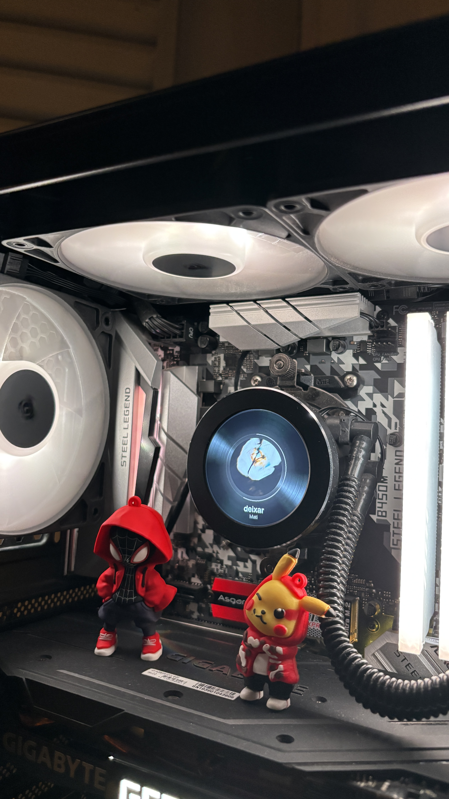
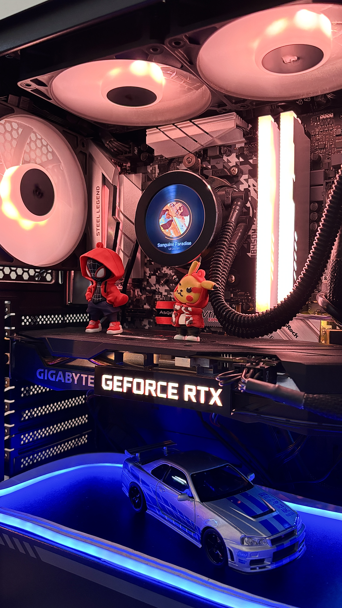
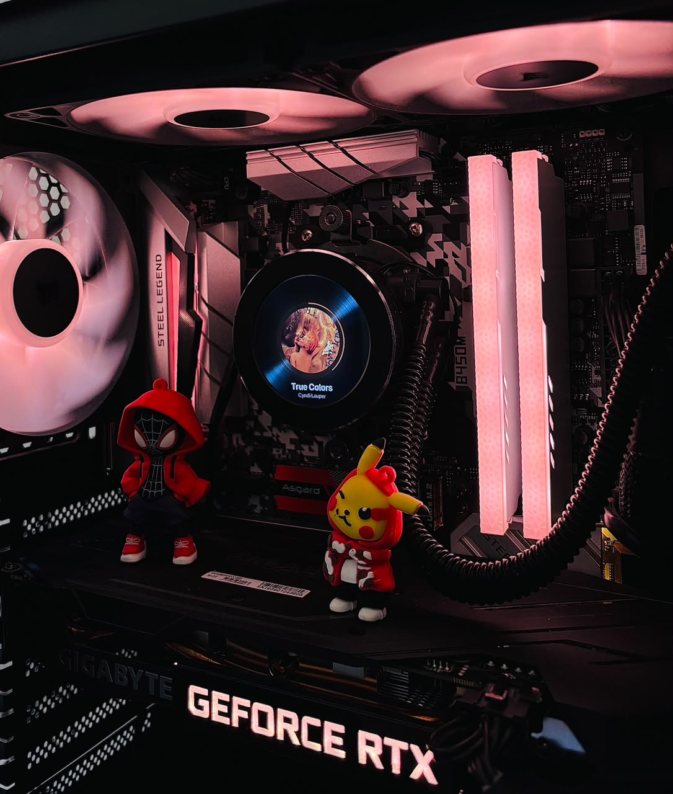
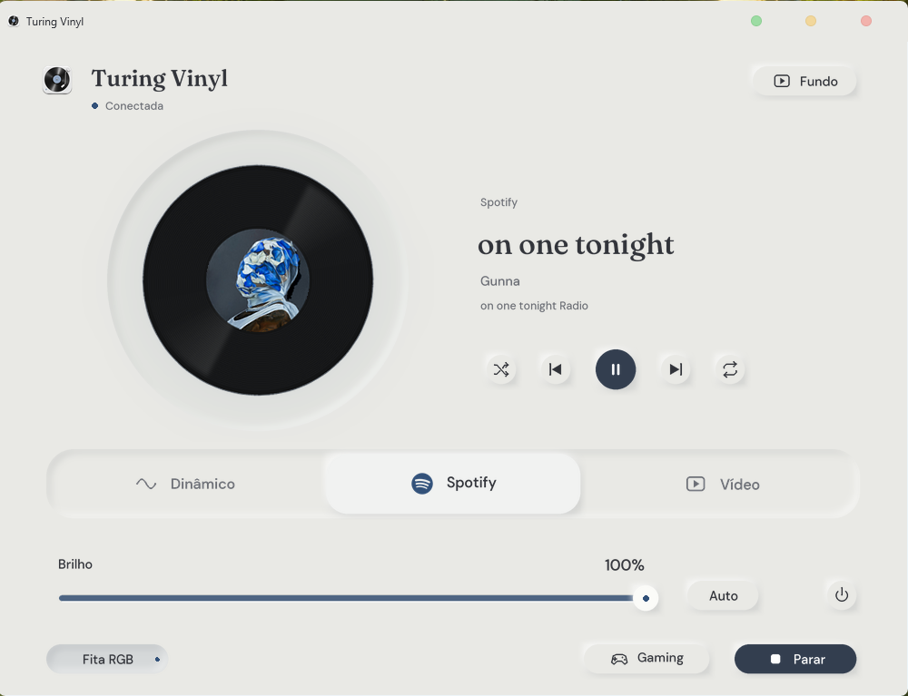
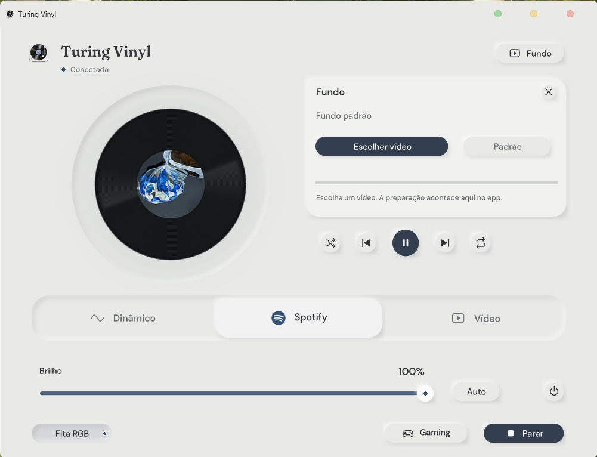

<h1 align="center">Turing Vinyl — Spotify for TURZX</h1>

<p align="center"><a href="README.pt-BR.md">Português</a> · <a href="README.md">English</a></p>

A **Windows desktop app** that turns a round **2.1-inch, 480 × 480 TURZX / Turing Smart Screen USB display** into an animated **Spotify vinyl record**, with album artwork and **OpenRGB** lighting. Built for a compatible water cooler LCD or secondary PC display.

<p align="center">
  
  
</p>

<p align="center">
  
</p>

https://github.com/user-attachments/assets/f876053e-42a8-4e0f-b7f9-6a048da14437

24-second demo: pause/resume, background transitions, synchronized RGB and the playlist entrance.

The record slows down on pause and accelerates on resume. Track changes flip the artwork; playlist and **Up next** cards share the same style. The app follows the album colors and provides brightness, playback and custom background controls.

**Jump to:** [Compatible display](#compatible-display) · [Install](#install) · [Use the app](#use-the-app) · [Integrations](#optional-integrations) · [Help](#need-help)

## Compatible display

The photographed setup uses a round **2.1-inch, 480 × 480 USB IPS display**, sold as *“2.1 Inch IPS Secondary Screen Water-Cooled Round Screen”*. The seller's customization software is **TURZX**.

- [Display listing on AliExpress](https://pt.aliexpress.com/item/1005006523861753.html).
- Turing Vinyl communicates with the display directly over USB; TURZX is not required to use this app.
- The current protocol uses USB device ID `1CBE:0088`. Similar-looking displays may use a different protocol; 2.8-inch models and other displays have not been validated.

## Install

**Requirements:** Windows 10/11, Python **3.13** with Tkinter (the version used in this setup), a compatible USB display, and an **NVIDIA GPU with NVENC** and its driver. Install FFmpeg and FFprobe on `PATH`, with the `h264_nvenc` and `libx264` encoders.

1. Download the repository using **Code → Download ZIP** and extract it.
2. Open PowerShell in the extracted folder and run this one-time setup:

```powershell
py -3.13 -m venv .venv
.\.venv\Scripts\python.exe -m pip install --upgrade pip
.\.venv\Scripts\python.exe -m pip install `
  Pillow libusb-package openrgb-python pycaw comtypes winrt-runtime `
  winrt-Windows.Foundation winrt-Windows.Foundation.Collections `
  winrt-Windows.Media winrt-Windows.Media.Control winrt-Windows.Storage.Streams `
  -e .\turing-smart-screen-cli-main
.\.venv\Scripts\python.exe criar_atalho.py
```

3. Double-click the **Turing Vinyl** shortcut created in the project folder. You can pin it to the taskbar.

Keep the extracted folder and its bundled videos in place: the shortcut uses this installation.

## Use the app

<p align="center">
  
</p>

1. Connect the display by USB and open **Spotify for Windows**.
2. Open **Turing Vinyl**, choose a mode and click **Iniciar** (Start).
3. Use **Parar** (Stop) to end the display session. Closing the app also ends its session.

The interface labels are currently in Portuguese.

| Mode | Display behavior |
| --- | --- |
| **Dinâmico** | Vinyl while music plays; background video while paused or idle. |
| **Spotify** | Vinyl stays on screen. On pause, it stops smoothly, the artwork shrinks and the glow/progress fade. |
| **Vídeo** | Background video only. |
| **Gaming** | Separate toggle: loops a prepared background at 30 FPS to reduce processing, without music overlays. Turning it off restores the selected mode. |

- **Brilho:** adjust brightness, use **Auto** for the time-based schedule or the power button to turn off the display. LEDs continue following the mode.
- **Playback:** shuffle, previous, play/pause, next and repeat below the track details. Controls depend on what Spotify exposes to Windows.
- **Fundo → Escolher vídeo:** choose your own background. The app converts it automatically, shows progress and saves the selection. **Padrão** restores the bundled video.

<details>
<summary>Screenshot: choosing a background</summary>

<p align="center">
  
</p>

</details>

## Optional integrations

### Playlist and Up next

Basic artwork, track details and playback controls use Windows media information. To enable playlist artwork and **Up next**:

1. Create an app in the [Spotify Developer Dashboard](https://developer.spotify.com/dashboard).
2. Set the Redirect URI to `http://127.0.0.1:8765/callback`.
3. Create `spotify_client_id.txt` in the project folder containing only the **Client ID**.
4. Click **Iniciar** in Turing Vinyl and authorize access in the browser when prompted.

No Client Secret is needed. Playlist cards last **5 seconds**; Up next appears about **22 seconds before the end**, for **7 seconds**, when Spotify returns the next track.

### RGB lighting

Enable the **OpenRGB SDK server** at `127.0.0.1:6742`. The current preset controls the **ASRock B450M Steel Legend** zones Addressable Header, PCH and IO Cover. During music, LEDs follow the album color; the idle profile is named `purple rain`.

Other controllers need their own configuration; RGB device selection is not yet available in the interface. Avoid having another RGB program control the same device simultaneously.

### Bluetooth RGB strip (Lotus Lantern, experimental)

Validated with one **ELK-BLEDDM** on Windows. Other controllers and strips have not been validated; the included calibration is a starting point for this setup.

1. Install [Node.js](https://nodejs.org/) (18 or newer), download and extract [Lotus Lantern for Windows](https://github.com/razibit/Lotus-Lantern-for-Windows-PC). Open PowerShell in the Lotus folder and run `npm ci` once.
2. Edit the Lotus `config.cmd`: set **your strip's** Bluetooth address in `set LED_DEVICE_UUID=AA11BB22CC33`, replacing the example with the 12 hexadecimal digits of the address. Keep the folder containing `config.cmd`, `src/ble-device.cjs` and `node_modules`.
3. Turn on Bluetooth and the strip, and close the mobile app and other bridges. In **Turing Vinyl**, enable **Fita RGB**, select the Lotus folder and click **Iniciar**. Right-click **Fita RGB** to change the folder; hover to see the connection status.

Turing Vinyl starts its own bridge on UDP `127.0.0.1:4048`. Keep the Lotus launcher closed for this integration; OpenRGB and Effects are not required for the strip. It follows the calibrated album color and screen brightness with smooth transitions, using the cached idle color during background video. Disabling **Fita RGB** leaves the last color on the strip.

<details>
<summary>Bluetooth address and calibration</summary>

If Windows has detected the strip, find its address in PowerShell:

```powershell
Get-PnpDevice -Class Bluetooth |
  Where-Object FriendlyName -Like 'ELK*' |
  Select-Object FriendlyName, InstanceId
```

For `BTHLE\DEV_AA11BB22CC33\...`, the address is `AA11BB22CC33`. Each strip has its own address; if it is missing, check device detection in Windows Bluetooth settings.

[calibracao_lotus.example.json](calibracao_lotus.example.json) supplies the default calibration automatically. To tune your strip, copy it to `calibracao_lotus.json` in the Turing Vinyl folder: this local file takes priority and is excluded from Git. `ganhos_rgb` balances the R/G/B channels; `ganhos_quentes` gradually adjusts warm tones. Each gain accepts values from 0 to 2; `[1, 1, 1]` makes that adjustment neutral. Changes are read while running.

Connection logs are saved to `diagnostico_leds/lotus.log`, with UTC timestamps.

</details>

## Need help?

| Problem | Check |
| --- | --- |
| Nothing appears after **Iniciar** | USB connection, compatible display, FFmpeg/NVENC and whether another app is using the screen. |
| Playlist / Up next is missing | Client ID, Redirect URI, browser authorization and internet connection. |
| Playback buttons are disabled | Open Spotify for Windows and start a track so its media session is available. |
| RGB does not respond | Motherboard detection in OpenRGB, SDK server and the supported preset. |

For a bug report, include the time, steps and a relevant excerpt from `tela.log` in the project folder, removing personal information. [Open an issue](https://github.com/pvict/TuringScreen-SpotifyVinyl/issues).

## Credits and license

USB communication: [Turing Smart Screen CLI](https://github.com/phstudy/turing-smart-screen-cli), with its [MIT license](turing-smart-screen-cli-main/LICENSE). Fonts: Fraunces and DM Sans, bundled under OFL. Another community project for these displays: [turing-smart-screen-python](https://github.com/mathoudebine/turing-smart-screen-python).

This repository has not yet declared a license for its own code and media. Turing Vinyl is an unofficial project by [Paulo](https://github.com/pvict).
